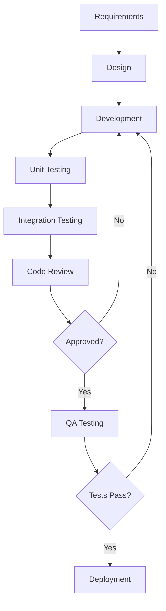

# Software Development Life Cycle (SDLC) Process Documentation
## Number System Converter Mobile Application

**Document Version:** 1.0  
**Date:** September 25, 2025  
**Project:** Number System Converter Mobile App  
**Document Type:** Process Documentation  

---

## 1. PROJECT OVERVIEW

### 1.1 Project Scope
Cross-platform mobile application for converting numbers between different number systems (Binary, Decimal, Octal, Hexadecimal) with persistent history and modern UI design.

### 1.2 SDLC Methodology
**Approach:** Agile Development with Iterative Releases  
**Framework:** React Native equivalent using Capacitor + React  
**Development Model:** Component-Driven Development (CDD)

---

## 2. SDLC PHASES IMPLEMENTATION

### Phase 1: Requirements Analysis and Planning

#### 2.1 Requirements Gathering
- **Functional Requirements:**
  - Number system conversion (Binary ↔ Decimal ↔ Octal ↔ Hexadecimal)
  - Input validation for each number system
  - Conversion history with persistence
  - Cross-platform mobile deployment
  - Modern gradient UI design

- **Non-Functional Requirements:**
  - Performance: Sub-second conversion response time
  - Usability: Intuitive touch-friendly interface
  - Compatibility: iOS 12+ and Android 8+
  - Storage: Local persistence using device storage
  - Accessibility: Screen reader compatible

#### 2.2 Technology Stack Selection
```
Frontend Framework: React 18 + TypeScript
Build Tool: Vite
Mobile Framework: Capacitor 7.x
UI Library: Radix UI (shadcn/ui)
Styling: Tailwind CSS
State Management: React Hooks + Context
Testing: Vitest + React Testing Library
Deployment: iOS App Store + Google Play Store
```

#### 2.3 Project Timeline
```
Phase 1 - Requirements & Design: 1 week
Phase 2 - Core Development: 2 weeks  
Phase 3 - Testing & QA: 1 week
Phase 4 - Deployment: 1 week
Total Duration: 5 weeks
```

### Phase 2: System Design and Architecture

#### 2.4 System Architecture
```
┌─────────────────────────────────────┐
│           Presentation Layer        │
│  ┌─────────────────────────────────┐│
│  │     React Components           ││
│  │  - ConverterScreen             ││
│  │  - ConversionScreen            ││
│  │  - HistoryScreen               ││
│  │  - BottomNavigation            ││
│  └─────────────────────────────────┘│
└─────────────────────────────────────┘
┌─────────────────────────────────────┐
│           Business Logic Layer      │
│  ┌─────────────────────────────────┐│
│  │     Utility Functions          ││
│  │  - numberConverter.ts          ││
│  │  - validation functions        ││
│  │  - conversion algorithms       ││
│  └─────────────────────────────────┘│
└─────────────────────────────────────┘
┌─────────────────────────────────────┐
│           Data Layer               │
│  ┌─────────────────────────────────┐│
│  │     Local Storage              ││
│  │  - Conversion History          ││
│  │  - User Preferences            ││
│  └─────────────────────────────────┘│
└─────────────────────────────────────┘
┌─────────────────────────────────────┐
│           Platform Layer           │
│  ┌─────────────────────────────────┐│
│  │        Capacitor               ││
│  │  - iOS Native Bridge           ││
│  │  - Android Native Bridge       ││
│  └─────────────────────────────────┘│
└─────────────────────────────────────┘
```

#### 2.5 Component Architecture
```
NumberConverterApp (Root)
├── BottomNavigation
├── ConverterScreen
│   ├── Input Component
│   ├── Dropdown Component
│   └── Convert Button
├── ConversionScreen
│   ├── Result Cards
│   └── Copy Functions
└── HistoryScreen
    ├── History List
    ├── Clear Button
    └── Empty State
```

### Phase 3: Implementation and Development

#### 2.6 Development Standards
- **Code Style:** ESLint + Prettier configuration
- **Type Safety:** Strict TypeScript with proper interfaces
- **Component Structure:** Functional components with hooks
- **State Management:** Custom hooks for complex state
- **Error Handling:** Try-catch blocks with user feedback

#### 2.7 Development Workflow
```
1. Feature Branch Creation
2. Component Development (TDD approach)
3. Unit Testing Implementation
4. Integration Testing
5. Code Review Process
6. Merge to Development Branch
7. QA Testing Phase
8. Production Deployment
```

### Phase 4: Testing and Quality Assurance

#### 2.8 Testing Strategy
- **Unit Testing:** Individual component testing (80% coverage target)
- **Integration Testing:** Component interaction testing
- **E2E Testing:** Complete user workflow testing
- **Device Testing:** iOS and Android device verification
- **Performance Testing:** Conversion speed and memory usage
- **Accessibility Testing:** Screen reader and keyboard navigation

#### 2.9 Quality Gates
```
├── Code Quality
│   ├── ESLint: 0 errors, 0 warnings
│   ├── TypeScript: Strict mode compliance
│   └── Test Coverage: >80%
├── Performance
│   ├── Bundle Size: <2MB
│   ├── Load Time: <3 seconds
│   └── Conversion Speed: <100ms
└── Compatibility
    ├── iOS: 12.0+
    ├── Android: API 26+
    └── Web Browsers: Modern browsers
```

### Phase 5: Deployment and Release

#### 2.10 Deployment Pipeline
```
Development → Staging → Production

1. Automated Building (Vite)
2. Capacitor Sync
3. Native Platform Building
4. Code Signing
5. App Store Submission
6. Release Notes Generation
```

#### 2.11 Release Strategy
- **Beta Testing:** Internal testing with 10 users
- **Soft Launch:** Regional release (test market)
- **Full Release:** Global availability
- **Post-Release:** Monitoring and hotfixes

### Phase 6: Maintenance and Support

#### 2.12 Maintenance Plan
- **Bug Fixes:** Critical issues within 24 hours
- **Feature Updates:** Monthly release cycle
- **Security Updates:** As needed basis
- **Performance Optimization:** Quarterly reviews

---

## 3. PROCESS WORKFLOWS

### 3.1 Development Workflow


### 3.2 Bug Resolution Workflow
```
1. Bug Report Submission
2. Severity Classification
3. Priority Assignment
4. Developer Assignment
5. Investigation & Diagnosis
6. Fix Implementation
7. Testing Verification
8. Code Review
9. Deployment to Production
10. Verification & Closure
```

### 3.3 Change Management Process
```
1. Change Request Submission
2. Impact Analysis
3. Technical Review
4. Approval/Rejection
5. Implementation Planning
6. Development & Testing
7. User Acceptance Testing
8. Production Deployment
9. Post-Implementation Review
```

---

## 4. QUALITY ASSURANCE PROCESSES

### 4.1 Code Review Checklist
- [ ] Functionality requirements met
- [ ] TypeScript types properly defined
- [ ] Error handling implemented
- [ ] Performance optimizations applied
- [ ] Security considerations addressed
- [ ] Accessibility standards met
- [ ] Test coverage adequate
- [ ] Documentation updated

### 4.2 Testing Protocols
```
Unit Testing:
├── Component Rendering Tests
├── Function Logic Tests
├── State Management Tests
└── Error Handling Tests

Integration Testing:
├── Component Interaction Tests
├── Data Flow Tests
├── Navigation Tests
└── Storage Tests

System Testing:
├── End-to-End User Workflows
├── Cross-Platform Compatibility
├── Performance Under Load
└── Security Vulnerability Scans
```

---

## 5. RISK MANAGEMENT

### 5.1 Technical Risks
| Risk | Probability | Impact | Mitigation Strategy |
|------|-------------|---------|-------------------|
| Platform compatibility issues | Medium | High | Extensive device testing |
| Performance degradation | Low | Medium | Regular performance monitoring |
| Third-party dependency issues | Medium | Medium | Dependency version locking |
| App store rejection | Low | High | Pre-submission compliance checks |

### 5.2 Project Risks
| Risk | Probability | Impact | Mitigation Strategy |
|------|-------------|---------|-------------------|
| Timeline delays | Medium | Medium | Agile methodology with sprints |
| Resource unavailability | Low | High | Cross-training team members |
| Scope creep | Medium | Medium | Clear requirements documentation |
| Budget overrun | Low | Medium | Regular cost monitoring |

---

## 6. DOCUMENTATION STANDARDS

### 6.1 Code Documentation
- Inline comments for complex logic
- JSDoc comments for all functions
- README files for each module
- API documentation for interfaces

### 6.2 Process Documentation
- SDLC process documentation (this document)
- Development workflows
- Testing procedures
- Deployment guides

### 6.3 User Documentation
- User manual
- Installation guides
- Troubleshooting documentation
- FAQ section

---

## 7. METRICS AND KPIs

### 7.1 Development Metrics
- Code coverage percentage
- Bug density per module
- Development velocity (story points/sprint)
- Code review turnaround time

### 7.2 Quality Metrics
- Defect escape rate
- Customer satisfaction score
- App store ratings
- Performance benchmarks

### 7.3 Business Metrics
- User adoption rate
- Feature usage statistics
- Support ticket volume
- Revenue/monetization metrics

---

## 8. COMPLIANCE AND STANDARDS

### 8.1 Coding Standards
- ESLint configuration compliance
- TypeScript strict mode
- React best practices
- Accessibility guidelines (WCAG 2.1)

### 8.2 Security Standards
- Data encryption for sensitive information
- Secure communication protocols
- Input validation and sanitization
- Regular security audits

### 8.3 Platform Standards
- iOS Human Interface Guidelines
- Material Design Guidelines (Android)
- App Store Review Guidelines
- Google Play Developer Policies

---

**Document Control:**
- Author: Software Development Team
- Reviewer: Technical Lead
- Approver: Project Manager
- Next Review Date: October 25, 2025